# Repository Guidelines

## Project Overview

This repository is a research reproduction and critical audit of **GTAE-IDS** (Ghadermazi et al., IEEE TIFS 2025) on **CIC-IDS2017**. It is a Python research pipeline, not a production service or installable library.

Three contributions drive the code:

1. **Leak-free reproduction**: parse 51 GB of raw pcap, label flows, build packet-level graphs, train 21 GTAE models, and evaluate under a temporal split (train Monday benign, test Tuesday–Friday).
2. **Forensic audit** of the authors' public code (`jalalgh7/*` repositories): same-day split, disconnected transformer encoder, OR voting, and label row-shift are documented in `docs/REPRO_AUDIT.md`.
3. **P1 proposal**: conformal calibration plus sequential early-exit (`src/calibrate.py`, `src/early_exit.py`).

Important: this is a **negative-result-heavy** project. The clean reproduction does **not** reach the paper's ~99% TPR. Use `results/*.csv` as the source of truth; several Markdown reports contain stale or inconsistent numbers (see **Known Pitfalls**).

## Architecture & Data Flow

```mermaid
flowchart LR
  A["pcap / pcapng"] --> B["src/parse_pcap.py<br/>5-tuple flows, first 8 packets"]
  B --> C["src/label.py<br/>CIC schedule + CSV cross-check"]
  C --> D["src/packet_encoder.py<br/>25 bytes/packet, 50p vector"]
  D --> E["src/build_dataset.py<br/>src/graph_builder.py<br/>node=(IP,port), edge=flow"]
  E --> F["src/line_graph.py + src/pe.py"]
  F --> G["src/model_gtae.py<br/>edge transformer autoencoder"]
  G --> H["src/train_gtae.py<br/>model.pt checkpoints"]
  H --> I["src/embed.py<br/>edge embeddings z"]
  I --> J["src/detectors.py<br/>IF / OCSVM / HBOS / INNE"]
  J --> K["src/eval.py<br/>TPR, FPR, AUROC, per-class"]
  I --> P["src/calibrate.py<br/>src/early_exit.py"]
  P --> K
```



### Stage contracts

| Stage | Entry point | Main output |
|---|---|---|
| Parse pcap | `python -m src.parse_pcap` | `data/processed/packets_{day}.parquet`, `flows_{day}.parquet` |
| Label flows | `python -m src.label` | `flows_{day}_labeled.parquet`, QA/crosscheck JSON in `reports/` |
| Build graphs | `python -m src.build_dataset` | `data/graphs/{T,R,T_fixed}/p{p}/{train1,train2,test}.npz` |
| Train | `src.train_gtae` / `scripts/train_all.py` | `experiments/.../model.pt`, `train_log.csv` |
| Embed | `src/embed.py` | `.npz` embeddings (`z`, `flow_id`, `day`, `y`, `attack_type`, `p`) or in-memory `z` |
| Detect + evaluate | `python -m src.eval` | per-run JSON + summary CSV |
| Baselines/P1 | `scripts/eval_baselines_p1.py` | `results/B0_summary.csv`, `B1_summary.csv`, `P1_summary.csv`, `P1_meta.json` |
| Audit | `scripts/audit_artifacts.py` | 428 cross-checks over raw/processed/graph artifacts |

### Data model and invariants

- **Protocol**: TCP over IPv4 only; UDP/ICMP are discarded.
- **Flow key**: canonical 5-tuple `(src IP, src port, dst IP, dst port, TCP)`.
- **Flow termination**: FIN/RST does not end a flow immediately; end on idle > 120 s or a new SYN after FIN/RST.
- **Packet budget**: first `p` packets per flow, `p ∈ {2..8}`. Only first 8 packets are stored.
- **Feature vector**: 9 IP bytes + 16 TCP bytes = **25 bytes/packet**; normalized by `/255`; direction-packed into **50 dimensions**; `p` packets → `50p` dimensions (`p=8` → 400).
- **Graph**: node = `(IP, port)` with **no node features**; edge = flow. One static graph per split/p, not a dynamic snapshot.
- **Labels**: `1=attack`, `0=benign`, `-1=UNCERTAIN`. Attack labels are used only for selection/evaluation; `train1`/`train2` contain benign flows only.
- **Splits**:
  - `T` (primary): `train1`/`train2` from Monday benign; test from Tuesday–Friday.
  - `R` (paper-like): random flow-level split across all days.
  - `T_fixed`: same flow population (`n_pkts_total ≥ 8`) for every `p`, used for p-curves and P1.
- **No scaler**: features are already `/255`; no fit-on-test preprocessing.
- **Model shape**: `ARCH` in `src/model_gtae.py`; p=8 uses 6 layers/8 heads/d=64, p=2 uses 3 layers/3 heads/d=8. Encoder output is the bottleneck `z`; decoder is a DNN back to `50p`.
- **Training sampler**: 2-hop edge-induced subgraphs, ≤200 edges, batch 50; evaluation/embedding uses the full graph.
- **Key constants**: `PE_DIM=8`, `K_max=32`, `contamination=0.01`, `calibration_fraction=0.2`, `target_fpr=0.01`; vote rules are `strict` (≥3/4) and `tie` (≥2/4).

### Artifact formats

- `GraphArrays` (frozen dataclass) and `.npz` keys: `edge_index` `[2,E] int32`, `edge_attr` `[E,50p] float32`, `y` `[E] int8`, `attack_type` `[E] str`, `flow_id` `[E] int64`, `day` `[E] str`, `num_nodes` scalar int64, `p` scalar int64. Cast scalar fields to Python `int` after load.
- `model.pt` checkpoint dict: `p`, `arch`, `pe_dim`, `use_pe`, `state_dict`. Loaded by `src.embed.load_model`.
- `results/M1_p{p}_seed{s}.json`: full per-detector, per-class, confusion details.
- `results/M1_summary.csv`: 21 models × 6 detector/ensemble rows.
- `results/P1_summary.csv`: P1 rows per seed/alpha/fusion method, including `auroc` and `tpr_at_fpr_1pct`.
- `results/P1_meta.json`: calibration fraction, seeds, alphas, packet budgets, `n_calib`.

## Key Directories

| Path | Purpose |
|---|---|
| `src/` | Core pipeline: parse, label, encode, graph, model, train, embed, detect, eval, P1. |
| `tests/` | Pytest suite for invariants (encoder, leakage, graph, label, model, detectors, P1). |
| `scripts/` | Multi-run orchestration, baselines/P1 evaluation, artifact audit, report generation. |
| `configs/` | `data.yaml` split/flow/sampling decisions; `cicids2017_schedule.yaml` attack windows. |
| `data/raw/` | 51 GB pcap + `GeneratedLabelledFlows` CSVs; **git-ignored**. |
| `data/processed/` | Packet/flow parquet tables; **git-ignored**. |
| `data/graphs/` | T/R/T_fixed `.npz` graphs (89 MB); **git-ignored**. |
| `experiments/` | Trained checkpoints/logs; **git-ignored**. |
| `results/` | Committed summary CSVs and per-run JSON. |
| `reports/` | QA reports, graph stats, comparison reports, paper-vs-ours. |
| `docs/` | Research notes, work plan, reproduction audit, paper PDF. |
| `demo/` | 5-minute CLI demo (loads real checkpoints/graphs). |
| `kaggle/`, `kaggle_long/` | Kaggle kernel metadata/scripts for GPU training. |
| `artifacts/` | Local checkpoint archives; **git-ignored**. |

## Development Commands

Use the local venv explicitly (`.venv/bin/python`) or activate it first:

```bash
source .venv/bin/activate
```

If recreating the environment, there is no `requirements.txt` yet:

```bash
python3 -m venv .venv
source .venv/bin/activate
# install the core stack: torch, pyod, scikit-learn, scipy, numpy, pyarrow, dpkt, pyyaml, pytest
```

### Tests and audit

```bash
pytest -q                                   # full suite, ~6 s
pytest tests/test_encoder.py -q             # one file
pytest tests/test_p1.py::test_fuse_fisher -q
python scripts/audit_artifacts.py           # 428 checks; needs data/ artifacts, ~47 s
```

### Data → graphs

```bash
# Parse one day
python -m src.parse_pcap \
  --pcap data/raw/Wednesday-workingHours.pcap \
  --out data/processed --day wednesday

# Label + QA + cross-check
python -m src.label \
  --flows data/processed/flows_wednesday.parquet \
  --offset-minutes -180 \
  --csv data/raw/GeneratedLabelledFlows/TrafficLabelling/Wednesday-workingHours.pcap_ISCX.csv \
  --out data/processed/flows_wednesday_labeled.parquet \
  --qa reports/qa_labeling_wednesday.json \
  --crosscheck reports/crosscheck_wednesday.json

# Build protocol T (p=2..8) and fixed population
python -m src.build_dataset --p 2 3 4 5 6 7 8 --out data/graphs
python -m src.build_dataset --p 2 3 4 5 6 7 8 --out data/graphs --tag T_fixed --min-packets 8

# Build protocol R
python -m src.build_dataset --split R --p 2 4 8 --out data/graphs
```

### Train and evaluate

```bash
# One model
python -m src.train_gtae --p 8 --graphs data/graphs/T \
  --out experiments/T/p8/seed0 --epochs 100 --seed 0 --device auto

# All p × seeds, resumable
python scripts/train_all.py --graphs data/graphs/T --out experiments/T \
  --ps 2 3 4 5 6 7 8 --seeds 0 1 2 --epochs 100 --resume

# Detector evaluation for trained models
python -m src.eval --models experiments/T --graphs data/graphs/T \
  --out results --ps 2 3 4 5 6 7 8 --seeds 0 1 2 --device cpu
```

### Baselines, P1, demo

```bash
# B0/B1/P1 (requires checkpoints + T_fixed). NOTE: see Known Pitfalls first.
PYTHONPATH=. python scripts/eval_baselines_p1.py

# P1-only rerun with a larger conformal calibration split, then report:
PYTHONPATH=. python scripts/eval_baselines_p1.py --p1-only --calibration-fraction 0.4
python scripts/make_p1_report.py      # regenerates reports/P1.md from CSV

# 5-minute demo; wrapper sets PYTHONPATH and cwd
./demo/run_demo.sh
```

### Reports and diagnostics

```bash
python scripts/make_qa_report.py       # reports/qa_labeling.md from JSON
python scripts/make_graph_stats.py     # reports/graph_stats.md from graph summaries

# Optional one-off diagnostics
python scripts/repro_cic_flows.py --pcap <pcap> --csv <cicflow csv> \
  --label <CIC label> --p 8 --out <out.npz>
python scripts/train_fullgraph.py --p 8 --graphs data/graphs/T \
  --out experiments/fullgraph --epochs 100 --seed 0
```

## Code Conventions & Common Patterns

- **Python 3.11**, `from __future__ import annotations`, type hints on public functions.
- **Style**: 4-space indent, double quotes, PEP 8-ish; no enforced formatter/linter config is present.
- **CLI shape**: `argparse` + `main(argv: list[str] | None = None) -> int`, called via `raise SystemExit(main())`.
- **Script import path**: scripts that import `src` prepend `REPO_ROOT` to `sys.path` (see `scripts/train_all.py`, `scripts/audit_artifacts.py`, `scripts/eval_baselines_p1.py`). Prefer `python -m src.<module>` for package entry points.
- **Numpy ↔ Torch**: data/artifacts stay in NumPy; convert to `torch` inside training/embedding and call `.cpu().numpy()` before writing results.
- **Determinism**: thread `seed` through `random.Random`, `np.random.default_rng`, and `torch.manual_seed`; do not use global RNG without a seed. `laplacian_pe` passes a seeded `v0` to ARPACK; removing it makes embeddings nondeterministic.
- **No PyG dependency**: graph/line-graph construction is plain NumPy; attention is plain PyTorch. Do not introduce PyG for small fixes.
- **Line-graph cap is mandatory**: a hub with degree `D` creates a `D(D-1)` clique. `K_max=32` is sampled in `src/line_graph.py`; never disable it on full graphs.
- **CPU vs GPU batching**: `src/train_gtae.py` defaults to batched block-diagonal subgraphs on CUDA and sequential subgraphs on CPU. Preserve this branch; CPU batched mode is usually slower.
- **No async/DI/state framework**: all pipeline scripts are synchronous; dependencies are passed explicitly as paths/model/device arguments; persistent state is files on disk (`parquet`, `npz`, `pt`, `csv`), with no database or long-running service.
- **Constants at module scope**: `ARCH`, `PE_DIM`, `DETECTOR_NAMES`, `DAYS`, `PE_KEEP`/`TCP_KEEP`-style tables. Extend these rather than scattering magic numbers.
- **Validation**: fail fast with `ValueError` for bad shapes/empty calibration; no broad exception swallowing in core code.
- **Progress output**: CLI scripts use `print(..., flush=True)` and JSON lines; no logging framework.
- **Generated vs manual**: `results/*.csv` and `results/M1_*.json` are measurements; Markdown reports are summaries and may be stale. Never overwrite a measurement CSV from a Markdown table.

### Naming conventions

- `p` = packet budget (`p2..p8`), `T` = temporal, `R` = random, `T_fixed` = fixed-population.
- Experiment names: `M1` (GTAE + detectors), `B0` (raw vector), `B1` (MLP-AE), `P1` (conformal early-exit).
- Detector names are exactly `IForest`, `OCSVM`, `HBOS`, `INNE`.
- Graph split keys are `train1`, `train2`, `test`.
- JSON/CSV fields use snake_case (`attack_type`, `flow_id`, `num_nodes`, `tpr_at_fpr_1pct`).

## Important Files

| File | Why it matters |
|---|---|
| `src/packet_encoder.py` | 25-byte feature contract, direction packing; `tests/test_encoder.py` pins Fig. 3. |
| `src/parse_pcap.py` | Streaming pcap parser; flow semantics and first-8-packet rule. |
| `src/label.py` | CIC schedule/NAT/port labeling; UNCERTAIN policy. |
| `src/build_dataset.py` | Protocol T/R/T_fixed sampling and graph artifacts. |
| `src/graph_builder.py` | `GraphArrays`, split selectors, `.npz` I/O. |
| `src/line_graph.py` | Edge→line-graph expansion, `K_max=32`, self-loops, symmetrization. |
| `src/pe.py` | LapPE `k=8`, seeded ARPACK start vector, edge PE `phi_u + phi_v`, random sign flips. |
| `src/model_gtae.py` | `ARCH` table for p=2..8; encoder/decoder. |
| `src/train_gtae.py` | Subgraph training loop, early stopping, checkpointing. |
| `src/detectors.py` | PyOD detectors, vote rules, rank-normalized fusion, metrics. |
| `src/eval.py` | Full model/detector evaluation CLI. |
| `src/calibrate.py` | Conformal p-values; Fisher/Bonferroni fusion. |
| `src/early_exit.py` | Sequential alpha-spending/early-exit evaluation. |
| `scripts/train_all.py` | Resumable 7 p × 3 seed runner. |
| `scripts/eval_baselines_p1.py` | B0/B1/P1 evaluation; writes measurement CSVs and `P1_meta.json`. |
| `scripts/make_p1_report.py` | Generates `reports/P1.md` from `results/P1_summary.csv`; do not hand-edit tables. |
| `scripts/audit_artifacts.py` | End-to-end artifact audit (428 checks). |
| `scripts/train_fullgraph.py` | One-off full-graph ablation (no 200-edge subgraph sampling). |
| `scripts/repro_cic_flows.py` | Rebuild authors' CICFlowMeter-style segmentation for comparison. |
| `configs/data.yaml` | Frozen flow/split/sampling decisions. |
| `configs/cicids2017_schedule.yaml` | 18 attack windows, attacker/victim/NAT/ports. |
| `tests/test_encoder.py` | Fig. 3 vector, options stripping, no IP/port leakage. |
| `tests/test_leakage.py` | Split disjointness and benign-only training invariants. |
| `tests/test_graph_builder.py` | Graph shape, day/flow IDs, deterministic rebuild. |
| `tests/test_p1.py` | Conformal p-values, fusion, early-exit behavior. |
| `results/M1_summary.csv` | Canonical M1 measurement table. |
| `results/B0_summary.csv` / `B1_summary.csv` | Canonical baseline measurements. |
| `results/P1_summary.csv` | Canonical P1 measurements (includes AUROC + TPR@FPR=1%). |
| `docs/REPRO_AUDIT.md` | Paper-vs-code forensic audit; source for the negative result. |
| `docs/WORK_PLAN.md` | Living plan/status; top-level status may overclaim. |

## Runtime/Tooling Preferences

- **Runtime**: Python **3.11.15** in a `uv`-managed `.venv/` (`uv 0.12.4`; see `.venv/pyvenv.cfg`); Linux x86_64; Bash.
- **Installed locally**: `torch 2.14.1+cpu`, `pyod 3.6.7`, `scikit-learn 1.9.1`, `scipy 1.17.1`, `numpy 2.4.6`, `pyarrow 26.0.0`, `dpkt 1.9.8`, `PyYAML 6.0.3`, `pytest 9.1.1`, `matplotlib 3.11.2`, `networkx 3.6.1`. `pandas` is **not** installed; use `pyarrow.parquet`.
- **Dependency manifest**: `requirements.txt` pins the direct runtime/tooling packages; there is still no `pyproject.toml` or lockfile. `pandas` is intentionally absent.
- **Training**: local CPU works for smoke tests; full 21-model training used Kaggle T4 (`kaggle/`, `kaggle_long/`). Kernels enable GPU/internet and are pushed with `kaggle kernels push -p kaggle` or `kaggle kernels push -p kaggle_long`; graph data is split across multiple Kaggle datasets and stitched by `kaggle_long/train_full.py`, then `scripts/train_all.py --resume` continues after session expiry. `src.train_gtae --device auto` selects CUDA when available.
- **Evaluation/demo**: CPU by default; `scripts/eval_baselines_p1.py` explicitly uses `torch.device("cpu")`.
- **No lint/typecheck config**: no Ruff/Black/Mypy config. Follow existing style; avoid repo-wide reformatting.
- **Large artifacts are ignored**: `data/`, `experiments/`, `*.pt`, `*.npy`, `artifacts/` are in `.gitignore`; a clean clone cannot run data-dependent tests/audit without downloading/building artifacts.

## Testing & QA

- **Framework**: `pytest` (config: `pytest.ini`; `testpaths = tests`, `pythonpath = .`; quiet mode). The `pythonpath` setting is why `pytest` works from the repo root without `PYTHONPATH`.
- **Run**: `pytest -q` (83 tests, ~6 s); single file/test as shown above.
- **Test style**: synthetic small arrays/graphs, fixed seeds, `tmp_path`, `pytest.approx`; no network, no real pcap, no model training.
- **Coverage by file**:
  - `test_encoder.py`: 25-byte Fig. 3 vector, IP/TCP options, direction packing, leakage.
  - `test_parse_pcap.py`: flow keying, SYN/FIN/idle semantics, packet storage.
  - `test_label.py`: schedule windows, NAT/ports, UNCERTAIN, QA summary.
  - `test_crosscheck.py`: CSV matching, AM/PM tolerance, confusion accounting.
  - `test_graph_builder.py`: graph shapes, split disjointness, deterministic rebuild.
  - `test_line_graph.py`: line-graph expansion, K_max, self-loops.
  - `test_pe.py`: LapPE shape/determinism (seeded ARPACK), edge PE.
  - `test_model_gtae.py`: `ARCH` shapes, forward/reconstruction shape.
  - `test_detectors.py`: detector fitting, vote rules, metrics.
  - `test_leakage.py`: no IP/port features, disjoint splits, benign-only train.
  - `test_p1.py`: conformal uniformity/shift, Fisher/Bonferroni, early-exit flow.
- **Artifact audit**: `python scripts/audit_artifacts.py` — 428 checks covering raw file presence/size, packet↔flow foreign keys, re-encoding, label domains, QA recomputation, crosscheck accounting, schedule consistency, split disjointness, deterministic graph rebuild, protocol R/T_fixed.
- **Not covered**: end-to-end CLI success, report/CSV consistency, real-data training convergence, GPU paths, latency. Tests are mostly synthetic; audit is the real-data check.
- **Adding tests**: put `tests/test_<area>.py`, use tiny synthetic inputs and explicit seeds, assert invariants/shapes/leakage rather than exact floats. Avoid training loops; mock/construct small checkpoints if needed.

## Known Pitfalls

1. **Measurement CSVs are the source of truth.** `scripts/eval_baselines_p1.py` writes `results/P1_summary.csv` + `results/P1_meta.json`; `scripts/make_p1_report.py` generates `reports/P1.md`. Do not hand-edit the generated report; re-run the generator instead.
2. **Some Markdown tables are manually maintained.** B0/B1/P1 numbers in `reports/report.md`, `README.md`, `reports/slides.md`, and `reports/paper_vs_ours.md` must be kept in sync with `results/*.csv`. If a number disagrees, trust the CSV.
3. **Conformal caveat**: Fisher fusion assumes independent p-values; the four detectors are correlated. Measured FPR is ~17.7% (α=0.05) and ~22.3% (α=0.10) for Fisher, so Fisher is exploratory only. Bonferroni with 800 calibration flows gives FPR 3.43% @ α=0.05 and 6.18% @ α=0.10.
4. **Calibration floor**: Bonferroni with 400 calibration flows cannot alert at α=0.05 because `4/401 ≈ 0.009975 > 0.05/7`. P1 defaults to `--calibration-fraction 0.4` (800 flows); keep that choice or document the floor. At FPR=1%, P1 Bonferroni is 0% TPR, below M1's 9.64%.
5. **Do not reintroduce IP/port/protocol into edge features.** The 25-byte encoding intentionally excludes them; `tests/test_leakage.py` and `test_encoder.py` pin this. Checksum bytes still depend on IP/port — known shortcut risk, not yet ablated.
6. **Do not use attack labels during training or detector fitting.** `train1`/`train2` must remain benign-only; only `test` labels are for evaluation.
7. **`demo/run_demo.py` needs `PYTHONPATH=.`** (or use `demo/run_demo.sh`, which sets it). It loads real checkpoints and `data/graphs/T_fixed`, so it fails on a clean clone without artifacts.
8. **Large files are intentionally untracked.** Do not `git add data/`, `experiments/`, `*.pt`, `*.npy`, or `artifacts/`.
9. **P1 CSV schema now includes `auroc` and `tpr_at_fpr_1pct`.** The ranking score is `1 - min_p` across packet budgets; `P1_meta.json` records calibration fraction and `n_calib`.
