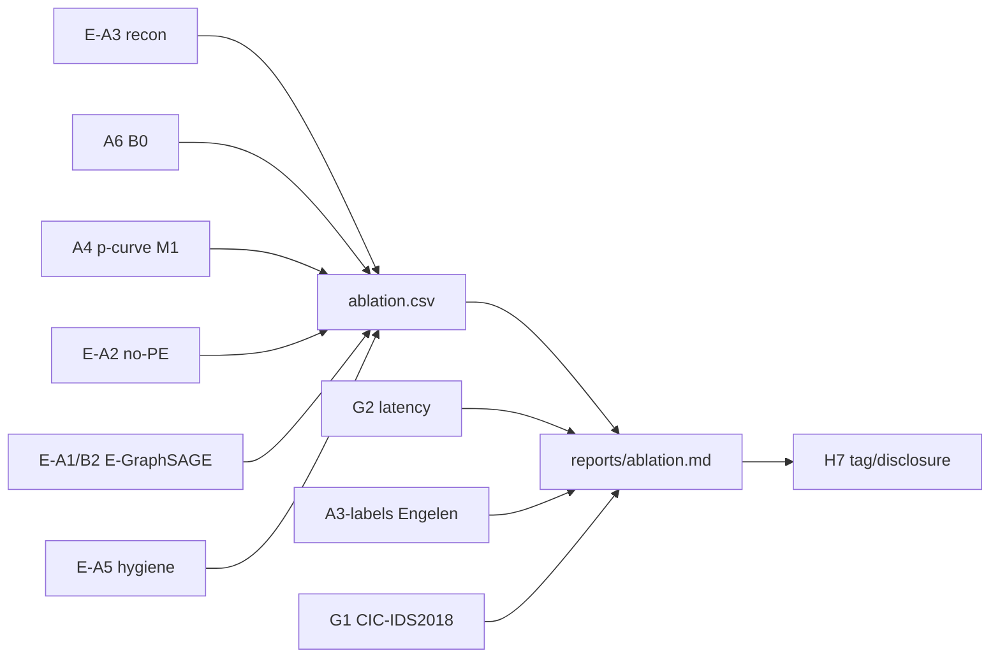

# Kế hoạch mở rộng còn lại

**Cập nhật:** 2026-11-10
**Trạng thái nền:** M1/B0/B1/P1 đã chạy deterministic; 83 pytest; 428 audit checks; P1 sinh tự động từ CSV.

**Nguyên tắc:**
- Không đổi M1/P1 đã chốt; mọi thí nghiệm mới ghi CSV riêng.
- Mỗi work tạo artifact + test (nếu là code) + commit nhỏ.
- Báo cáo Markdown sinh từ CSV; không hard-code số.
- Ưu tiên thí nghiệm rẻ, tái dùng checkpoint trước; train mới chạy trên Kaggle nếu CPU quá chậm.

---

## 0. Trạng thái triển khai

- `[x]` **E-A3**: `scripts/eval_recon_ablation.py` + `scripts/make_ablation_report.py`; chạy trên Kaggle T4 (kernel `tdwuyn/gtae-ids-ablation-recon`); kết quả p=8: **23,65% TPR @ 4,17% FPR**, AUROC 0,676.
- `[x]` **A4/A6 consolidation**: `results/ablation.csv`, `reports/ablation.md`.
- `[x]` **E-A2**: train p=8 × 3 seed với `--no-pe` trên Kaggle T4; eval local. Kết quả: **6,21% ± 7,97% TPR @ 2,24% FPR**, AUROC 0,690, TPR@1% 9,31%. LapPE không phải yếu tố quyết định; seed variance cao.
- `[ ]` G2 latency, E-A1/B2, E-A5 hygiene, A3-labels Engelen, G1 CIC-IDS2018, H7.

## 1. Thứ tự ưu tiên

| Ưu tiên | Work | Lý do | Est |
|---|---|---|---|
| **P0** | E-A3 reconstruction-error + A4/A6 consolidation | Không cần train; có ngay một ablation thật | 1 ngày |
| **P0** | E-A2 no-PE | CLI đã có `--no-pe`; chỉ cần train/eval | 0,5–1 ngày |
| **P1** | G2 latency | Đo được ngay; phục vụ claim “real-time” | 1 ngày |
| **P1** | E-A1/B2 E-GraphSAGE-AE | Trả lời “graph transformer có cần thiết không?” | 2 ngày |
| **P2** | E-A5 header hygiene | Kiểm tra shortcut TTL/checksum | 1–1,5 ngày |
| **P2** | A3-labels Engelen corrected | Phụ thuộc dữ liệu ngoài; eval-only | 1–2 ngày |
| **P3** | G1 CIC-IDS2018 subset | Domain shift; tốn dung lượng/thời gian | 2–3 ngày |
| **Cuối** | H7 tag + AI disclosure | Chỉ làm sau khi chốt kết quả | 0,5 ngày |

> Đây là estimate part-time, không phải cam kết. Nếu thiếu thời gian, cắt theo thứ tự từ dưới lên: G1 → A3-labels → A5 → B2.

---

## 2. Chi tiết từng work

### 2.1. E-A3 — Reconstruction-error detector (không train)

**Mục tiêu:** kiểm tra A3 trong `docs/WORK_PLAN.md`: thay 4 detector bằng ngưỡng reconstruction error của GTAE.

**Cách làm:**
1. Tạo `scripts/eval_recon_ablation.py`:
   - Load `model.pt`, `train2.npz`, `test.npz`.
   - Dựng line graph + LapPE giống `src/embed.py`.
   - `recon, _ = model(x, line, pe)`; `err = mean((recon - x)^2, dim=1)`.
   - Threshold = quantile 0.99 của `train2` errors; predict `err > threshold`.
   - Dùng `src.detectors.metrics` với `calibration_scores=train2_err`.
2. Ghi `results/A3_recon_p{p}_seed{s}.json` và `results/A3_recon.csv`.
3. Chạy p=2,4,8 × seed 0,1,2 (9 run, không train).

**Lệnh dự kiến:**
```bash
python scripts/eval_recon_ablation.py \
  --graphs data/graphs/T_fixed --models experiments/T \
  --ps 2 4 8 --seeds 0 1 2 --out results
```

**Acceptance:**
- 9 run; CSV có `tpr,fpr,auroc,tpr_at_fpr_1pct`.
- So sánh trực tiếp với M1 cùng p/seed; ghi delta.
- Không sửa checkpoint/model.

**Commit dự kiến:** `feat(ablation): add reconstruction-error detector`.

---

### 2.2. A4/A6 + `results/ablation.csv`

**Mục tiêu:** gom B0, B1, M1 p-curve, E-A3, A2, B2, A5 thành một bảng ablation thống nhất.

**Cách làm:**
1. Tạo `scripts/make_ablation_report.py` đọc:
   - `results/B0_summary.csv`, `B1_summary.csv`, `M1_summary.csv`.
   - `results/A3_recon.csv`, `results/A2_no_pe.csv`, `results/B2_summary.csv`, `results/A5_hygiene.csv` (nếu có).
2. Chuẩn hóa cột: `experiment,p,seed,model,rule,tpr,fpr,auroc,tpr_at_fpr_1pct`.
3. Sinh `results/ablation.csv` + `reports/ablation.md`.
4. A4 = p-curve M1 p=2..8; A6 = B0; không cần chạy lại.

**Acceptance:**
- `results/ablation.csv` có ít nhất B0/B1/M1/E-A3.
- `reports/ablation.md` sinh tự động, không hard-code.
- Mọi delta tính cùng p/seed/rule.

**Commit dự kiến:** `feat(ablation): consolidate baseline table`.

---

### 2.3. E-A2 — Bỏ LapPE

**Mục tiêu:** đo đóng góp của LapPE (A2).

**Cách làm:**
```bash
python scripts/train_all.py \
  --graphs data/graphs/T --out experiments/T_noPE \
  --ps 8 --seeds 0 1 2 --epochs 100 --no-pe --resume

python -m src.eval \
  --models experiments/T_noPE --graphs data/graphs/T \
  --out results/noPE --ps 8 --seeds 0 1 2 --device cpu
```
Sau đó đổi tên/chuẩn hóa thành `results/A2_no_pe.csv` trong script ablation.

**Acceptance:**
- 3 checkpoint, val MSE hợp lý, không NaN.
- CSV cùng format M1; delta TPR/FPR/AUROC so M1 p=8.
- Ghi rõ nếu chênh lệch nằm trong nhiễu seed.

**Commit dự kiến:** `feat(ablation): add no-PE retrain`.

---

### 2.4. G2 — Latency end-to-end

**Mục tiêu:** đo ms/flow, µs/packet, thời gian chờ p gói; phục vụ claim “real-time”.

**Cách làm:**
1. Tạo `scripts/bench_latency.py`:
   - Parse/encode: `encode_edge` trên packet rows có sẵn.
   - Graph + PE + encoder forward: batch 1 và batch lớn (256/1024).
   - Detector score: 4 PyOD models.
   - `time.perf_counter`, warmup 5, repeat 30; báo median + p95.
   - Đo thêm `wait_p = t_p - t_1` từ packet timestamps (p=2..8).
2. Ghi `results/latency.csv` với `device,cpu/gpu,batch,stage,median_ms,p95_ms,us_per_packet,notes`.
3. Ghi rõ CPU/GPU và phiên bản torch; không trộn số CPU với GPU.

**Acceptance:**
- CSV tái chạy được; metadata device.
- Có ít nhất parse+encode, encoder, detector, end-to-end.
- Không suy ra “real-time” nếu p95 vượt ngân sách; báo trung thực.

**Commit dự kiến:** `feat(eval): add latency benchmark`.

---

### 2.5. E-A1/B2 — E-GraphSAGE-AE

**Mục tiêu:** baseline đồ thị không transformer, cùng protocol/feature/detector.

**Cách làm:**
1. Tạo `src/model_egraphsage.py`:
   - Input `x [E,50p]`; line graph adjacency (hoặc node-edge incidence).
   - 2 lớp mean-aggregation: `h_e' = MLP([h_e, mean_{kề} h_k])`; residual/LN tùy chọn.
   - Decoder DNN giống GTAE; `encode`/`forward` cùng interface.
2. Mở rộng `src/train_gtae.py`:
   - Thêm `--model {gtae,egraphsage}` và factory.
   - Checkpoint thêm `model_type`; `src/embed.load_model` dispatch.
3. Test:
   - `tests/test_model_egraphsage.py`: shape/forward/PE optional.
4. Train p=8 × 3 seed (Kaggle/CPU), eval cùng detector:
```bash
python scripts/train_all.py --graphs data/graphs/T --out experiments/T_b2 \
  --ps 8 --seeds 0 1 2 --epochs 100 --model egraphsage --resume
python -m src.eval --models experiments/T_b2 --graphs data/graphs/T \
  --out results/b2 --ps 8 --seeds 0 1 2 --device cpu
```

**Acceptance:**
- 3 checkpoint load được; eval CSV.
- So M1 cùng p/seed/rule; kết luận “transformer có cần không?” dựa trên delta, không suy diễn quá mức.
- Nếu B2 tương đương M1, ghi rõ trong report.

**Commit dự kiến:** `feat(b2): add E-GraphSAGE autoencoder`.

---

### 2.6. E-A5 — Header hygiene

**Mục tiêu:** kiểm tra shortcut TTL/checksum (A5).

**Cách làm:**
1. Mở rộng `src/packet_encoder.py`:
   - Thêm variant `hygiene`: bỏ TTL (IP byte 8), IP checksum (10–11), TCP checksum (16–17) → 20 byte/gói; block 40p.
   - Giữ API `encode_edge(..., variant="paper"|"hygiene")`.
2. Mở rộng `src/build_dataset.py` / `src/graph_builder.py` nhận `--encoder-variant hygiene`; build `data/graphs/T_hygiene` p=8.
3. Train p=8 × 3 seed, eval; ghi `results/A5_hygiene.csv`.
4. Test encoder mới; audit graph shape.

**Acceptance:**
- 20 byte/gói, 40p vector; test vector mới.
- So M1 p=8: nếu TPR/FPR giảm mạnh → bằng chứng shortcut; nếu không → ghi nhận.
- Không trộn graph hygiene với checkpoint paper.

**Commit dự kiến:** `feat(ablation): add header-hygiene variant`.

---

### 2.7. A3-labels — Engelen corrected labels (eval-only)

**Mục tiêu:** đánh giá ảnh hưởng của nhãn CIC đã sửa; **không train lại**.

**Cách làm:**
1. Tải artifact nhãn sửa của Engelen et al. (SPW 2021) từ nguồn công bố; lưu `data/raw/engelen/`.
2. Tạo `src/corrected_labels.py`:
   - Load corrected labels.
   - Map vào flow của `flows_{day}_labeled.parquet` bằng 5-tuple + timestamp (± tolerance).
   - Báo coverage (% flow map được), confusion primary-vs-corrected.
3. Tạo `scripts/eval_corrected.py`:
   - Dùng lại embeddings/checkpoint M1 (không train).
   - Tính metrics với nhãn corrected; so primary.
4. Ghi `results/corrected_labels.csv` + `reports/corrected_labels.md`.

**Acceptance:**
- Báo coverage và confusion rõ ràng.
- Không dùng corrected labels để train/tune.
- Nếu không tải được dữ liệu: ghi blocker, không bịa số.

**Commit dự kiến:** `feat(eval): add Engelen corrected-label evaluation`.

---

### 2.8. G1 — CIC-IDS2018 subset (MAY)

**Mục tiêu:** kiểm tra domain shift và FPR thật trên benign 2018.

**Cách làm:**
1. Chọn 1 ngày benign + 1 ngày attack (subset nhỏ); kiểm tra dung lượng trước.
2. Parse bằng `src.parse_pcap`; label bằng CSV 2018 (không có schedule 2017).
3. Build graph p=8; zero-shot dùng model 2017; eval FPR/TPR.
4. Ghi `results/2018_summary.csv` + `reports/2018.md`.

**Acceptance:**
- Có benign thật để tính FPR.
- Ghi rõ subset, ngày, số flow; không claim đại diện toàn bộ 2018.
- Nếu dung lượng/quyền truy cập chặn: đánh dấu out-of-scope, không chặn báo cáo.

**Commit dự kiến:** `feat(eval): add CIC-IDS2018 subset`.

---

### 2.9. H7 — Tag + AI disclosure

**Cách làm:**
1. Tạo `docs/AI_DISCLOSURE.md`: công cụ dùng, phạm vi hỗ trợ, cách nhóm kiểm chứng số liệu/test.
2. Chạy lại `pytest -q`, `scripts/audit_artifacts.py`, `make_p1_report.py`.
3. `git tag -a v1.0 -m "GTAE-IDS reproduction + audit + P1"`; push tag.
4. Kiểm tra `git status` sạch.

**Acceptance:**
- Tag trỏ commit sạch; disclosure có trong repo.
- Không tag trước khi các bảng số đã đồng bộ CSV.

---

## 3. Dependency graph



---

## 4. Lịch gợi ý

| Ngày | Việc |
|---|---|
| 1 | E-A3 + A4/A6 + `ablation.csv`/`ablation.md` |
| 2 | E-A2 no-PE + bắt đầu G2 |
| 3 | G2 latency; review kết quả |
| 4–5 | E-A1/B2 E-GraphSAGE |
| 6 | E-A5 header hygiene |
| 7–8 | A3-labels Engelen (nếu có dữ liệu) |
| 9–11 | G1 CIC-IDS2018 (nếu còn thời gian) |
| 12 | H7 tag + disclosure + tổng duyệt |

---

## 5. Bắt đầu ngay

1. `[x]` E-A3: script + Kaggle GPU run hoàn tất; kết quả trong `results/A3_recon.csv` và `reports/ablation.md`.
2. `[ ]` Tiếp theo: E-A2 no-PE — chạy `scripts/train_all.py --no-pe` trên Kaggle, rồi `src.eval`.
3. `[ ]` Sau đó G2 latency; B2/A5 chỉ làm khi `results/ablation.csv` đã ổn định.
4. `[ ]` A3-labels Engelen và G1 CIC-IDS2018 cần dữ liệu ngoài; kiểm tra dung lượng trước.

**Không làm trước:** B2/A5 khi chưa có A2; G1 khi chưa chốt A3/A2/B2.
